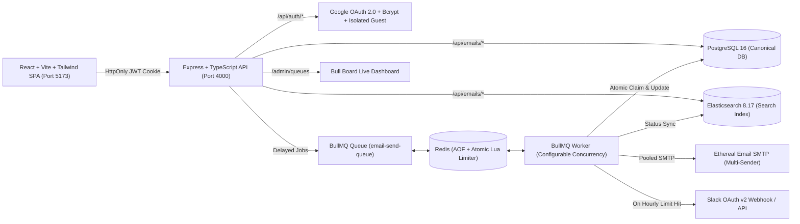

# ReachInbox — Full-Stack Email Job Scheduler (`EmailJobScheduler`)

A production-grade, persistent email scheduling service and Figma-matched dashboard built with **TypeScript**, **Express.js**, **BullMQ**, **Redis**, **PostgreSQL**, **Elasticsearch**, **Ethereal SMTP**, **React + Vite + Tailwind CSS**, **Google OAuth 2.0**, and **Slack OAuth 2.0**.

---

## Table of Contents
1. [Architecture Overview](#1-architecture-overview)
2. [How Scheduling, Persistence & Rate Limiting Work](#2-how-scheduling-persistence--rate-limiting-work)
3. [Project Structure](#3-project-structure)
4. [Environment & OAuth Setup](#4-environment--oauth-setup)
5. [Running the Application](#5-running-the-application)
6. [API Reference](#6-api-reference)
7. [Verification, Tests & 1,050-Email Simulation](#7-verification-tests--1050-email-simulation)
8. [Features Mapped to Requirements](#8-features-mapped-to-requirements)
9. [Security & Data Isolation](#9-security--data-isolation)
10. [Assumptions, Shortcuts & Trade-offs](#10-assumptions-shortcuts--trade-offs)

---

## 1. Architecture Overview



### Core Components
- **Frontend (`frontend/`):** React 19, TypeScript, Tailwind CSS v4, TipTap rich-text editor, DOMPurify HTML sanitization, Lucide icons.
- **Backend API & Worker (`backend/`):** Express.js, TypeScript, PostgreSQL (`pg` + versioned SQL migrations), Redis (`ioredis`), BullMQ (`Queue` + `Worker` + `@bull-board/express`), Elasticsearch (`@elastic/elasticsearch`), Nodemailer (multi-sender pooled Ethereal & custom SMTP), Zod validation.

---

## 2. How Scheduling, Persistence & Rate Limiting Work

### Scheduling Without Cron Jobs
- **Zero cron jobs:** No `node-cron`, `agenda`, OS `crontab`, or polling loops exist anywhere in the project.
- When `POST /api/emails/schedule` receives a campaign with `N` recipients, `startTime`, `delayBetweenSeconds`, and optional `hourlyLimit`:
  1. Inside a single PostgreSQL transaction, a `campaigns` record and `N` `emails` rows are inserted with deterministic `idempotency_key`s and staggered `scheduled_at = startTime + index * delayMs`.
  2. All documents are bulk-indexed into **Elasticsearch** (`reachinbox_emails`).
  3. All jobs are enqueued in **BullMQ** via `queue.addBulk()` with `jobId = email.id` and `delay = Math.max(0, scheduledAt - now)`.

### Persistence & Idempotency Across Restarts
- **Redis AOF + PostgreSQL Source of Truth:** Delayed jobs persist in Redis (`appendonly yes`) and continue firing at their scheduled timestamps after restarts without restarting from scratch.
- **One-Time Startup Reconciliation (`reconcilePendingJobsOnStartup`):** Runs once when the server or standalone worker boots:
  - Recovers any stale `processing` rows (>60s without `sent_at`) back to `scheduled`.
  - Compares pending DB records (`scheduled`, `queued`, `rate_limited`) against Redis (`emailQueue.getJob(email.id)`) and re-enqueues only missing jobs with remaining delay. Already `sent` or `cancelled` emails are never re-queued.
- **Atomic Worker Claim:** Before sending over SMTP, the worker executes:
  ```sql
  UPDATE emails
  SET status = 'processing', attempt_count = attempt_count + 1, updated_at = NOW()
  WHERE id = $1 AND status IN ('scheduled', 'queued', 'rate_limited')
  RETURNING *;
  ```
  If `0` rows are returned, the job exits cleanly—guaranteeing **zero duplicate sends** under concurrent workers, retries, or crash recovery.

### Worker Concurrency, Minimum Delay & Hourly Rate Limiting
- **Worker Concurrency:** Configured via `WORKER_CONCURRENCY` (default `5`) on the BullMQ `Worker`.
- **Minimum Delay Between Sends:** Enforced via `MIN_DELAY_BETWEEN_EMAILS_MS` (default `2000` ms = **2 seconds minimum per sender**) and overridable per campaign.
- **Multi-Worker Safe Atomic Redis Lua Script (`backend/src/services/rateLimiterService.ts`):**
  - Checks `ratelimit:hour:sender:{senderId}:{hourBucket}` against the sender/campaign/env limit (`MAX_EMAILS_PER_HOUR_PER_SENDER`) and `ratelimit:hour:global:{hourBucket}` against `MAX_EMAILS_PER_HOUR_GLOBAL`.
  - Coordinates per-sender spacing (`ratelimit:spacing:sender:{senderId}` and `ratelimit:spacing:reserved:{senderId}`) so parallel workers reserve non-overlapping future slots (`job.moveToDelayed(slot, token)` + `DelayedError`) instead of blocking worker concurrency with `sleep`.
  - **Behavior Under 1,000+ Email Load:** Hourly counters are only incremented when a send slot is granted. Once an hourly cap is reached, excess jobs are **never dropped or permanently failed**—a next-hour slot counter (`ratelimit:nextslot:sender:{senderId}:{nextHourBucket}`) assigns staggered timestamps into the next hour window, updates PostgreSQL and Elasticsearch to `rate_limited`, and delays the job cleanly via `moveToDelayed`.

### Live Slack Notification on Rate Limit Hit
- Users click **Connect Slack** in the dashboard → real Slack OAuth v2 (`https://slack.com/oauth/v2/authorize` → `/api/integrations/slack/callback`) protected by single-use PostgreSQL `oauth_states`.
- OAuth access tokens and incoming webhook URLs are encrypted with **AES-256-GCM** in `slack_integrations`.
- The moment any sender hits its hourly rate limit, the worker fires a live Slack Block Kit alert to the connected channel (deduplicated per `(userId, senderId, hourBucket)` only while Slack is connected).
- Disconnecting Slack stops notifications cleanly with zero errors; connecting or reconnecting mid-hour clears suppression keys and immediately activates notifications without a redeploy.

---

## 3. Project Structure

```text
reachinbox-email-scheduler/
├── docker-compose.yml              # PostgreSQL 16, Redis 7 (AOF), Elasticsearch 8.17
├── package.json                    # Root convenience scripts
├── README.md
├── backend/
│   ├── .env.example                # Environment template (no secrets committed)
│   ├── package.json
│   ├── tsconfig.json
│   ├── vitest.config.ts
│   ├── src/
│   │   ├── app.ts                  # Express app, Helmet, CORS, routes, Bull Board
│   │   ├── index.ts                # API + embedded BullMQ worker entrypoint
│   │   ├── workerEntry.ts          # Optional standalone BullMQ worker process
│   │   ├── config/                 # env, db, redis, elasticsearch, AES-256-GCM encryption
│   │   ├── db/migrations/          # Versioned SQL schema migrations
│   │   ├── middleware/             # JWT cookie auth, Bull Board auth, error handler
│   │   ├── routes/                 # auth, senders, emails, slack, health
│   │   ├── services/               # auth, sender, smtp, rateLimiter, slack, search, queue, worker, email
│   │   ├── scripts/simulateLoad.ts # 1,050-email load + ES + restart + live Ethereal simulation
│   │   └── types/index.ts
│   └── tests/                      # Rate limiter, Slack lifecycle, auth isolation, scheduler integration
└── frontend/
    ├── index.html
    ├── package.json
    ├── vite.config.ts
    └── src/
        ├── api/client.ts           # Typed HTTP client with credentials
        ├── context/                # AuthContext, ToastContext
        ├── pages/                  # LoginPage, DashboardPage, ComposePage
        ├── components/             # Sidebar, TopHeader, EmailList, EmailRow, EmailDetailView, RichTextEditor, SendLaterPopover, SlackConnectModal, SenderManageModal
        └── utils/                  # csvParser (+ unit tests), formatters
```

---

## 4. Environment & OAuth Setup

### Prerequisites
- Node.js 20+ LTS
- PostgreSQL 16+
- Redis 7+ (or Redis 5+ with AOF enabled)
- Elasticsearch 8.17+

*(Or start PostgreSQL, Redis, and Elasticsearch via `docker compose up -d` at the repository root.)*

### 1. Create `backend/.env`
```bash
cp backend/.env.example backend/.env
```
Generate 32+ character secrets for `JWT_SECRET` and `TOKEN_ENCRYPTION_KEY`:
```bash
node -e "console.log(require('crypto').randomBytes(48).toString('hex'))"
node -e "console.log(require('crypto').randomBytes(32).toString('hex'))"
```

All scheduler limits live in `backend/.env` (zero hardcoded limits):
```env
RUN_EMBEDDED_WORKER=true
GUEST_LOGIN_ENABLED=true
WORKER_CONCURRENCY=5
MIN_DELAY_BETWEEN_EMAILS_MS=2000
MAX_EMAILS_PER_HOUR_PER_SENDER=50
MAX_EMAILS_PER_HOUR_GLOBAL=200
EMAIL_JOB_MAX_ATTEMPTS=3
```

### 2. Google OAuth 2.0 Setup (Required for Google Login)
1. Open [Google Cloud Console](https://console.cloud.google.com/) → **APIs & Services** → **Credentials**.
2. Configure the **OAuth Consent Screen** with scopes `openid`, `email`, `profile`.
3. Create an **OAuth client ID** (**Web application**):
   - Authorized JavaScript origin: `http://localhost:5173`
   - Authorized redirect URI: `http://localhost:4000/api/auth/google/callback`
4. Set `GOOGLE_CLIENT_ID`, `GOOGLE_CLIENT_SECRET`, and `GOOGLE_CALLBACK_URL` in `backend/.env`.

*(Note: **Continue as Guest** is also available when `GUEST_LOGIN_ENABLED=true` so reviewers can enter an isolated demo workspace immediately before configuring Google OAuth.)*

### 3. Slack OAuth 2.0 Setup (Required for Live Rate-Limit Alerts)
1. Go to [Slack API Apps](https://api.slack.com/apps) → **Create New App** → **From scratch**.
2. Under **OAuth & Permissions → Redirect URLs**, add `http://localhost:4000/api/integrations/slack/callback`.
3. Under **Bot Token Scopes**, add `incoming-webhook` and `chat:write`.
4. Set `SLACK_CLIENT_ID`, `SLACK_CLIENT_SECRET`, and `SLACK_REDIRECT_URI` in `backend/.env`.

### 4. Ethereal Email Setup
- Every new user automatically receives a live Ethereal SMTP sender (via `nodemailer.createTestAccount()`, or using `DEFAULT_ETHEREAL_USER` / `DEFAULT_ETHEREAL_PASS` if provided in `.env`).
- Additional Ethereal senders can be provisioned in 1 click inside the UI via **SMTP Senders → Create Ethereal** or added via custom SMTP credentials.
- Sent emails display a **View in Ethereal** preview link in the Email Detail view.

---

## 5. Running the Application

```bash
# 1. Start PostgreSQL, Redis, and Elasticsearch
docker compose up -d

# 2. Install & start Backend (API + migrations + Elasticsearch init + BullMQ worker + Bull Board)
cd backend
npm install
npm run dev

# Optional: run worker in a separate process (set RUN_EMBEDDED_WORKER=false in backend/.env)
npm run dev:worker

# 3. Install & start Frontend
cd ../frontend
npm install
npm run dev
```

- **Frontend Dashboard:** `http://localhost:5173`
- **Backend API & Health:** `http://localhost:4000/api/health`
- **Live BullMQ Dashboard:** `http://localhost:4000/admin/queues` *(sign in on the dashboard first or set `BULL_BOARD_BASIC_USER` / `BULL_BOARD_BASIC_PASSWORD`)*

---

## 6. API Reference

| Method & Endpoint | Auth | Description |
|---|---|---|
| `GET /api/health` | Public | Reports PostgreSQL, Redis, Elasticsearch, and worker status |
| `GET /api/auth/google` & `/callback` | Public | Real Google OAuth 2.0 flow with CSRF `state` validation |
| `POST /api/auth/register` & `/login` | Public | Bcrypt email/password account signup and login |
| `POST /api/auth/guest` | Public | Creates an isolated guest user + Ethereal sender session |
| `GET /api/auth/me` & `POST /api/auth/logout` | Cookie/JWT | Session inspection and cookie logout |
| `GET /api/senders`, `POST /api/senders/ethereal`, `POST /api/senders`, `DELETE /api/senders/:id` | Required | Multi-sender management, live Ethereal provisioning, hourly usage snapshot |
| `POST /api/emails/schedule` | Required | Schedules bulk/single emails (`multipart/form-data` or JSON) |
| `GET /api/emails`, `GET /api/emails/counts`, `GET /api/emails/:id` | Required | Elasticsearch-powered tab listing/search, counts, detail view |
| `PATCH /api/emails/:id`, `DELETE /api/emails/:id`, `GET /api/emails/:id/attachments/:attachmentId` | Required | Star/archive flags, cancel/delete job, authenticated attachment download |
| `GET /api/integrations/slack/status`, `/connect`, `/callback`, `DELETE /`, `POST /test` | Required | Slack OAuth v2 connect, disconnect, and live alert testing |
| `GET /admin/queues` | Session / Basic | Live BullMQ Bull Board UI |

---

## 7. Verification, Tests & 1,050-Email Simulation

```bash
# Backend typecheck, build, tests (12 tests across 4 files), and 1,050-email load simulation
cd backend
npm run typecheck
npm run build
npm test
npm run simulate:load

# Frontend typecheck, unit tests (2 tests), and production build
cd ../frontend
npm run typecheck
npm test
npm run build
```

What the automated suite & simulation verify:
- **Rate Limiter (`rateLimiter.test.ts`):** Per-sender hourly caps, staggered next-hour rescheduling, multi-sender isolation, and concurrent minimum delay reservation.
- **Slack Lifecycle (`slackDisconnectReconnect.test.ts`):** Safe no-op when disconnected, immediate activation on mid-hour connect without redeploy, hourly deduplication, and clean disconnect.
- **Auth & Tenant Isolation (`authIsolation.test.ts`):** Protected `/admin/queues` & API rejection, cross-user & cross-guest isolation, zero encrypted credential leakage, CSRF OAuth state rejection.
- **Scheduler, Elasticsearch & Restart Survival (`scheduler.integration.test.ts`):** Elasticsearch sync, live rate-limit overflow rescheduling + Slack trigger, duplicate job skip via atomic claim, and **worker stop → restart delivery survival without duplication**.
- **Scale & Live Ethereal (`simulateLoad.ts`):** Schedules 1,050 emails into PostgreSQL + BullMQ + Elasticsearch, runs exact Elasticsearch lookup, verifies missing-job reconciliation after simulated Redis loss, and delivers a live Ethereal SMTP message.

---

## 8. Features Mapped to Requirements

- **Backend:** BullMQ delayed scheduler (no cron), PostgreSQL transactional persistence & idempotency, startup job reconciliation, configurable concurrency, atomic Redis Lua per-sender/global hourly limits + min-delay spacing, multi-sender Ethereal SMTP, Elasticsearch indexing & search, protected Bull Board queue dashboard, real Google OAuth & Slack OAuth rate-limit alerts.
- **Frontend:** Figma-matched Login screen (Google OAuth, email/password, isolated Guest), Sidebar (`ONB` logo, profile dropdown, `Compose`, `Scheduled`/`Sent` live counts), Search/Filter/Refresh header with user profile & Logout, Scheduled & Sent email lists with loading/empty states, Email Detail view (DOMPurify-sanitized HTML, attachments, Ethereal preview link), Compose New Email (`From` selector, pill chips + CSV/TXT lead upload count, delay/hourly limit inputs, TipTap editor, `Send Later` popover, attachment cards).

---

## 9. Security & Data Isolation
- Zero secret fallbacks in code (`JWT_SECRET` and `TOKEN_ENCRYPTION_KEY` validated strictly on startup).
- SMTP passwords and Slack OAuth tokens/webhooks encrypted with AES-256-GCM before persisting in PostgreSQL and never returned in API payloads.
- All database, Elasticsearch, attachment, sender, and Slack queries enforce `user_id` ownership.
- Minimal BullMQ job payloads (`{ emailId, userId, senderId }`) ensure email bodies and credentials are never stored in Redis or displayed in Bull Board.
- Single-use CSRF `state` tokens in PostgreSQL `oauth_states`, `HttpOnly` JWT cookies, open-redirect validation, and DOMPurify HTML sanitization.

---

## 10. Assumptions, Shortcuts & Trade-offs
1. **Fixed UTC Hour Buckets (`Math.floor(nowMs / 3600000)`):** Hourly limits align to UTC hour windows rather than sliding 60-minute windows so next-hour reschedule timestamps (`nextHourStartMs`) are deterministic under 1,000+ job spikes.
2. **Hourly Slack Alert Deduplication:** When a sender hits its hourly limit and reschedules a batch of jobs, Slack receives one structured alert per `(userId, senderId, hourBucket)` rather than spamming one message per overflow email; connecting or disconnecting resets this state immediately.
3. **Minimal Queue Payloads:** Workers fetch email body HTML and decrypted sender SMTP credentials from PostgreSQL at send time instead of duplicating sensitive data into Redis job payloads.
4. **Elasticsearch Refresh Mode:** Document writes use `refresh: 'wait_for'` so newly scheduled or sent emails appear immediately in dashboard searches at a minor indexing latency trade-off.
